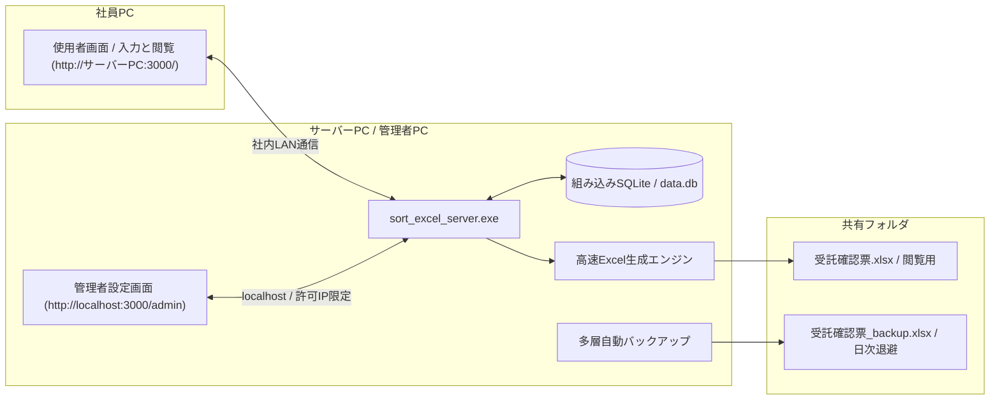

# 受託確認票 業務管理サーバー (sort_excel_server)

社員全員が1つのExcelを直接編集する運用をなくし、ブラウザから安全に入力 / 更新できるようにするためのスタンドアロン型Webシステムです。
データが更新されるたびに、書式が綺麗に整った最新のExcelファイルを自動生成します。



---

## 主な特徴

* 単一のexeファイルで完結
  * PythonやNode.js、外部データベースなどの追加ソフトをインストールする必要がありません。
  * Web画面、SQLiteデータベース、Excel生成エンジンがすべて `sort_excel_server.exe` の中に内蔵されています。

* ブラウザ上でソート済みスケジュールを直接確認 / 編集
  * Excelファイルを開かなくても、ブラウザ上で5つのビューを切り替えて閲覧できます。
  * 案件一覧タブ: 全案件の検索、担当者やステータスによる絞り込み、新規登録を行えます。
  * 日付別スケジュールタブ: 画面左側のカレンダーリストから日付を選ぶと、その日の融資実行と金消 / 面談の予定が、担当順や時間順にソートされた状態で表示されます。今日や直近の日付へワンクリックで移動できます。
  * 融資実行日順シートタブ / 金消日と面談日順シートタブ / 統合データシートタブ: Excelに出力される各シートと同一の並び順をブラウザ上でそのまま確認できます。
  * どのビューからでも行をクリックすると右側から編集パネルが開き、その場で内容を修正できます。

* 表記ゆれの防止と自由入力の両立
  * 形態、依頼内容、担当、当日申請、ステータスの各項目はドロップダウン選択式で表記ゆれを防ぎます。
  * 各選択肢の一番下にある `その他 / 自由入力` を選ぶとテキスト入力欄がすぐ下に現れ、選択肢にない特殊な内容でもその場で自由に記入して登録できます。
  * 日付はカレンダーピッカーから選択するため、日付列に不正な文字列やメモが混ざることがありません。

* 操作者の記録と改ざん不可の監査ログ
  * 初めてアクセスしたIPアドレスのPC（または操作者が未設定のブラウザ）では、最初に操作者の選択画面と使い方ガイドが自動で開きます。リストにない名前はその場で追加でき、動作確認用の `[テスト] テスト用` アカウントも用意されています。
  * いつ、どのIPアドレス / ホスト名のPCから、誰が、どの案件のどの項目をどう変更したかがデータベースに自動記録されます。
  * 監査ログは追記専用で設計されており、管理者画面からも含めて削除や改ざんができない仕組みになっています。

* 使用者画面と管理者画面の分離およびIPアクセス制御
  * 使用者画面は案件の閲覧、検索、新規登録、編集に特化した構成です。
  * 管理者画面はサーバーを起動しているPC自身、または管理者が許可した特定IPアドレスのPCからのみアクセス可能です。
  * 管理者画面のアクセスログ一覧から、不審な接続元IPをワンクリックでアクセス遮断したり、特定の社員PCのIPに管理者権限を付与したりできます。

* 社内共有URLのワンクリックコピーとショートカット作成
  * 管理者画面の上部に、社員へ案内するための共有URLが自動検出されて表示され、ワンクリックでコピーできます。
  * 画面右上のメニューやタスクトレイアイコンから、デスクトップにシステムのショートカットアイコンをワンクリックで作成できます。
  * 画面右上のメニューから全画面表示モードに切り替えて、広い画面で一覧を確認することも可能です。

* 社員から管理者への不具合 / 改善要望報告とGitHub連携
  * 一般の社員が不具合や改善要望を見つけた際は、画面右上のメニューから報告フォームを開いて送信できます。
  * 送信された報告はいったん管理者画面の `不具合報告 / GitHub起票` タブに集約されます。
  * 管理者は内容を確認して対応ステータスを管理でき、開発者へエスカレーションしたい項目は `GitHub Issueを作成` ボタンからタイトルと本文が自動入力された状態でGitHub Issuesへ起票できます。
  * ライセンス表記やオープンソースの権利表記は管理者画面の専用タブにのみ配置し、一般の使用者画面をシンプルに保っています。

* 高速なExcel自動生成と多層バックアップ
  * 案件が登録または更新された瞬間に、共有フォルダの `受託確認票.xlsx` を自動で最新化します。
  * 生成されるシートは、全33列マスターの `受託確認票`、`sorted_by_融資実行日`、`sorted_by_金消日・面談日`、`統合データ`、および各日付別シートです。
  * 全セルに点線罫線、上下左右中央揃え、文字の自動縮小、列幅の自動調整を適用します。
  * Excel上書き直前の状態を常に `受託確認票_backup.xlsx` として退避するほか、毎日定時に日次バックアップを保存し、管理者画面からワンクリックで復元できます。

---

## 起動方法と画面の使い分け

### サーバーの起動手順

* フォルダ内にある `sort_excel_server.exe` をダブルクリックします。
* コンソール画面が立ち上がり、同時にWindows右下のタスクトレイにアイコンが常駐します。
* タスクトレイのアイコンを右クリックすると、以下の操作をいつでも行えます。
  * 使用者画面を開く
  * 管理者設定画面を開く
  * デスクトップにショートカットを作成
  * Excel出力先フォルダを開く
  * サーバーを終了

### 使用者画面

* URL: `http://[サーバーPC名またはIP]:3000/` （サーバーPC自身からは `http://localhost:3000/`）
* 主な機能:
  * 初回アクセス時の操作者設定と、ヘッダーでの操作者切り替え / 新規追加
  * 5つのビュータブによる案件の検索、絞り込み、日付別スケジュールの確認
  * 新規案件の登録と既存案件の編集、ゴミ箱への移動
  * Excelの手動即時出力
  * 右上の `メニュー` から全画面表示切り替え、デスクトップショートカット作成、使い方ガイドの表示、管理者への不具合 / 要望報告

### 管理者設定画面

* URL: `http://localhost:3000/admin` （または管理者権限を付与したIPから `http://[サーバーPC]:3000/admin`）
* 権限があるPCで使用者画面を開いている場合は、画面右上に `管理者設定画面へ` ボタンが自動表示されます。
* 主な機能:
  * 画面上部の案内バー: 社員PCへ共有するためのアクセスURLのワンクリックコピー
  * 担当順 / ソート条件タブ: 担当者の優先順位の並べ替えや追加 / 削除、日付別シートの第1から第3ソートキーと昇順 / 降順の設定
  * 選択肢マスター管理タブ: 形態、依頼内容、当日申請、ステータスの定型選択肢の追加 / 編集
  * 出力先 / 自動化設定タブ: Excelの出力先フォルダパス、ファイル名、バックアップ保持日数、自動出力のオン / オフ設定
  * Excel一括取り込みタブ: 既存のExcelファイルからの一括インポート（重複を防ぐ総入れ替えモード、または追加モードを選択可能）
  * バックアップ / 復元タブ: 手動バックアップの即時作成と、過去の日次バックアップからのワンクリック復元
  * ゴミ箱タブ: 誤って削除された案件の復元、またはデータベースからの完全削除
  * アクセス / 操作ログタブ: 変更前後の差分を含む全操作履歴の閲覧、接続元IPのアクセス遮断 / 解除、特定IPへの管理者権限付与 / 解除
  * 不具合報告 / GitHub起票タブ: 使用者から届いた報告の確認、ステータス管理、GitHub Issuesへのワンクリック起票
  * ライセンス / 権利表記タブ: システム本体のMITライセンスおよび使用オープンソースライブラリの権利表記の確認

---

## ファイルとフォルダの構成

`sort_excel_server.exe` を配置したフォルダには、起動時に以下のファイルやフォルダが自動作成されます。

* `sort_excel_server.exe`: システム本体の実行ファイルです。
* `data.db`: 登録されたすべての案件情報、設定、監査ログ、不具合報告を保持するSQLiteデータベースファイルです。
* `exports/`: 自動生成されたExcelファイルが出力される既定フォルダです（管理者画面から任意の共有フォルダパスへ変更可能）。
  * `受託確認票.xlsx`: 最新のExcelファイルです。
  * `受託確認票_backup.xlsx`: 上書き直前の退避ファイルです。
* `backups/`: 毎日定時に自動保存される日次バックアップフォルダです。

---

## ビルド方法（開発者向け）

Rustのツールチェーンが導入されている環境で、以下のコマンドにより単一バイナリをビルドできます。

```powershell
cd server
cargo build --release
Copy-Item target\release\sort_excel_server.exe ..\sort_excel_server.exe -Force
```
