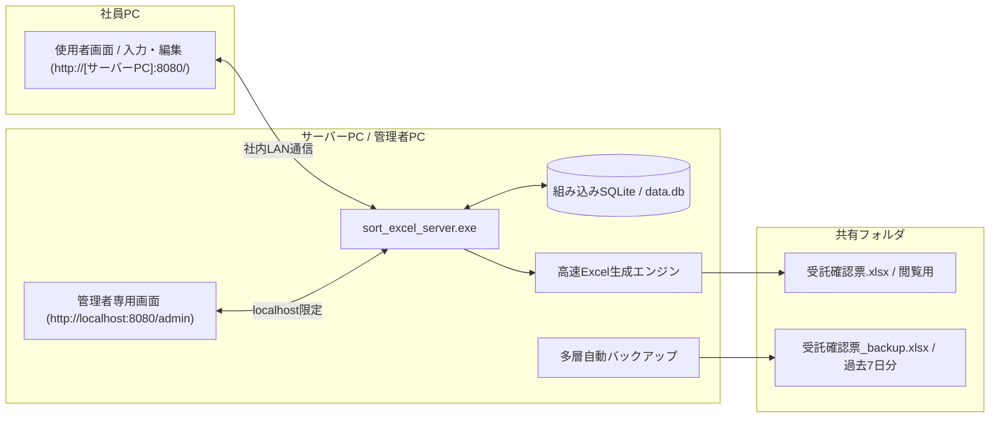

# 受託確認票 業務管理サーバー (sort_excel_server)

社員全員が1つのExcelを直接編集する運用をなくし、ブラウザから安全に入力 / 更新できるようにするためのスタンドアロン型Webシステムです。
データが更新されるたびに、書式が綺麗に整った最新のExcelファイルを自動生成します。

---

## 主な特徴

* 単一のexeファイルで完結
  * PythonやNode.js、外部データベースなどの追加ソフトをインストールする必要が一切ありません。
  * Web画面（HTML / CSS / JavaScript）、SQLiteデータベース、Excel生成エンジンがすべてexeファイルの中に内蔵されています。

* 使用者画面と管理者画面の完全分離
  * 使用者画面（`http://[サーバーPC]:8080/`）は案件の検索、新規登録、編集に特化したシンプルな構成です。
  * 管理者画面（`http://localhost:8080/admin`）はサーバーを起動している管理者PCからのみアクセス可能であり、社員PCからはアクセスできないようブロックされています。

* 表記ゆれの防止と自由入力の両立
  * 形態、依頼内容、担当、当日申請、ステータスの各項目はドロップダウン選択式で表記ゆれを防ぎます。
  * 同時に、各選択肢の一番下にある `その他（自由入力...）` を選ぶとテキスト入力欄がすぐ下に現れ、選択肢にない特殊な内容でもその場で自由に記入して登録できます。
  * 日付はカレンダーピッカーから選択するため、日付列に不正な文字列やメモが混ざることがありません。

* 高速なExcel自動生成
  * 案件が登録または更新された瞬間に、共有フォルダの `受託確認票.xlsx` を自動で最新化します。
  * 第1シート: 全33列一覧マスター `受託確認票`
  * 第2シート: 融資実行日順 `sorted_by_融資実行日`
  * 第3シート: 金消日 / 面談日順 `sorted_by_金消日・面談日`
  * 第4シート: 統合データ
  * 第5シート以降: 日付別シート（管理者設定のソートキーと担当者の優先順位に従い並べ替え済み）
  * 全セルに点線罫線、上下左右中央揃え、文字の自動縮小、列幅の自動調整を適用しています。

* セキュリティ対策の徹底
  * CORS（クロスオリジン通信）を無効化し、外部Webサイトからの不正なデータ読み出しや操作を遮断しています。
  * 管理者API（設定変更、一括インポート、バックアップ復元、ゴミ箱管理）はループバック接続（localhost）のみ許可し、出力ファイル名のパストラバーサル検証も行っています。

* 多層の自動バックアップと復元機能
  * リアルタイム退避: Excel上書き直前の状態を常に `受託確認票_backup.xlsx` として自動保存します。
  * 日次バックアップ: 毎日定時に `YYYY.MM.DD 受託確認票.xlsx` とデータベースファイルをバックアップフォルダへ保存し、直近7日分（日数変更可）を維持します。管理者画面からワンクリックで指定日時点へ復元できます。

---

## 起動方法と画面の使い分け

### サーバーの起動手順

* フォルダ内にある `sort_excel_server.exe` をダブルクリックします。
* 黒い案内画面が立ち上がり、同時にWindows右下のタスクトレイ（インジケーター）にアイコンが常駐します。
* タスクトレイのアイコンを右クリックすると、使用者画面や管理者設定画面、Excel保存先フォルダをいつでも開けます。

### 使用者画面（社員PCおよびローカル共用）

* URL: `http://[サーバーPC名またはIP]:8080/` （サーバーPC自身からは `http://localhost:8080/`）
* できること:
  * 案件一覧の検索（お客様氏名、物件名、仲介、備考）と担当者やステータスによる絞り込み
  * 新規案件の登録と既存案件の編集（選択リスト + 自由入力対応）
  * 案件の削除（ゴミ箱への移動）
  * Excelの手動即時出力

### 管理者設定画面（サーバーPC専用）

* URL: `http://localhost:8080/admin`
* サーバーPC上で使用者画面を開いている場合は、画面右上に `管理者設定画面へ` ボタンが自動表示されます（他のPCには表示されません）。
* できること:
  * 担当順 / ソート条件設定: 担当者の優先順位の並べ替えや追加 / 削除、日付別シートの第1〜第3ソートキーと昇順 / 降順の設定
  * 選択肢マスター管理: 形態、依頼内容、当日申請、ステータスの定型選択肢の追加 / 編集
  * 出力先 / 自動化設定: Excelの出力先フォルダパス（共有フォルダパスなど）、ファイル名、バックアップ保持日数、自動出力のオン / オフ設定
  * Excel一括取り込み: 既存のExcelファイルからの一括インポート（重複を防ぐ総入れ替えモード、または追加モードを選択可能）
  * バックアップ / 復元: 手動バックアップの即時作成と、過去の日次バックアップからのワンクリック復元
  * ゴミ箱（削除済み案件管理）: 誤って削除された案件の復元、またはデータベースからの完全削除

---

## ファイルとフォルダの構成

exeファイルを配置したフォルダには、起動時に以下のファイルやフォルダが自動作成されます。

* `sort_excel_server.exe`: システム本体の実行ファイルです。
* `data.db`: 登録されたすべての案件情報や設定を保持するSQLiteデータベースファイルです。
* `exports/`: 自動生成されたExcelファイルが出力される既定フォルダです（管理者画面から任意の共有フォルダパスへ変更可能）。
  * `受託確認票.xlsx`: 社員が閲覧する最新のExcelファイルです。
  * `受託確認票_backup.xlsx`: 上書き直前の直前退避ファイルです。
* `backups/`: 毎日定時に自動保存される日次バックアップフォルダです。
