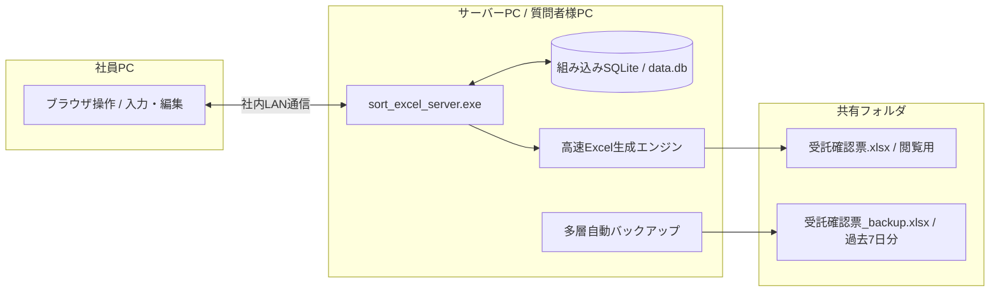

# 受託確認票 業務管理サーバー (sort_excel_server)

社員全員が1つのExcelを直接編集する運用をなくし、ブラウザから安全に入力 / 更新できるようにするためのスタンドアロン型Webシステムです。
データが更新されるたびに、書式が綺麗に整った最新のExcelファイルを自動生成します。

---

## 主な特徴

* 単一のexeファイルで完結
  * PythonやNode.js、外部データベースなどの追加ソフトをインストールする必要が一切ありません。
  * Web画面（HTML / CSS / JavaScript）、SQLiteデータベース、Excel生成エンジンがすべてexeファイルの中に内蔵されています。

* 社員向け案件ダッシュボード
  * お客様氏名や物件名の一部を入力するだけで目的の案件が見つかるリアルタイム検索機能。
  * 担当者別フィルターや、進行中 / 日程未定 / リスケなどのステータス絞り込み。
  * 表の行をクリックすると画面右側に編集パネルが開き、日時や担当者をサクサク修正可能。
  * 複数人が同時に同じ案件を編集した際の上書き警告（衝突防止）。

* 表記ゆれの完全防止
  * 形態、依頼内容、担当、当日申請などの項目はドロップダウン選択式です。
  * 日付はカレンダーピッカーから選択するため、日付列に不正な文字列やメモが混ざることがありません。
  * "リスケ" や "見積" などの状態はステータス欄やメモ欄に分離して入力できます。

* 高速なExcel自動生成
  * 案件が登録または更新された瞬間に、共有フォルダの "受託確認票.xlsx" を自動で最新化します。
  * 第1シート: 従来の全33列一覧マスター "受託確認票"
  * 第2シート: 融資実行日順 "sorted_by_融資実行日"
  * 第3シート: 金消日・面談日順 "sorted_by_金消日・面談日"
  * 第4シート: 統合データ
  * 第5シート以降: 日付別シート（担当者の優先順位と時間順に並べ替え済み）
  * 全セルに点線罫線、上下左右中央揃え、文字の自動縮小、列幅の自動調整を適用しています。

* 多層の自動バックアップ
  * リアルタイム退避: Excel上書き直前の状態を常に "受託確認票_backup.xlsx" として自動保存します。
  * 日次バックアップ: 毎日定時に "YYYY.MM.DD 受託確認票.xlsx" とデータベースファイルをバックアップフォルダへ保存し、直近7日分を維持して古いものは自動削除します。

* 管理者向け機能
  * 担当者の優先順位（日付別シートでの並び順）を画面上で上下ボタンにより手軽に並べ替え可能。
  * 形態や依頼内容の選択肢マスターの自由な追加 / 編集。
  * 過去の受託確認票Excelからデータを一括で取り込めるインポート機能。

---

## 起動方法と使い方

### サーバーの起動手順

* フォルダ内にある `sort_excel_server.exe` をダブルクリックします。
* 黒い案内画面が立ち上がり、稼働メッセージが表示されます。
* 同時にパソコンの既定ブラウザが自動で開き、管理画面（http://localhost:8080）が表示されます。
* 普段はこの案内画面を最小化しておけば、バックグラウンドで静かに動き続けます。

### 社員PCからのアクセス方法

社員のみなさんは、専用ソフトのインストールなしで利用できます。

* 社員のパソコンでブラウザ（EdgeやChromeなど）を開きます。
* アドレスバーに `http://[サーバーPC名]:8080` または `http://[サーバーPCのIPアドレス]:8080` を入力してアクセスします。
* ブックマーク（お気に入り）に登録しておくと次回からワンクリックで開けます。

### 共有Excelの閲覧

* `exports/受託確認票.xlsx` に常に最新のExcelが出力されます。
* 社員のみなさんはこのファイルを直接開いて確認や印刷を行えます。
* セルの内容を修正したいときは、Excelを直接書き換えるのではなく、Web画面から修正して保存します。

### サーバーの終了手順

* 案内画面の "×" ボタンを押すか、キーボードで Ctrl+C を押すと安全に終了します。

---

## 各画面の操作方法

### 案件一覧と検索

* 画面上部の検索枠にお客様氏名や物件名を入力すると、即座に該当の案件だけに絞り込まれます。
* 担当プルダウンから特定の担当者を選んで、自分の案件だけを表示できます。
* 条件クリアボタンを押すと、すべての案件が再表示されます。

### 案件の編集（進捗更新）

* 一覧の中で更新したい行をクリックします。
* 画面右側からスライドイン編集パネルが開きます。
* 融資実行日や金消日、立会者、ステータスなどを変更します。
* 画面下の "保存してExcel更新" ボタンを押すと、即座にデータベースと共有Excelが最新化されます。

### 新規案件の登録

* 画面右上の "+ 新規案件を登録" ボタンを押します。
* 空の入力パネルが開くので、お客様氏名、形態、依頼内容、担当などを入力します。
* "保存してExcel更新" ボタンを押すと登録完了です。

### 管理設定

画面右上の "管理設定" ボタンを押すと、以下の設定が行えます。

* 担当順の設定: 日付別シートで優先して上に並べる担当者の順序を上下ボタンで変更できます。新しい担当者の追加も可能です。
* 選択肢マスター: 形態や依頼内容のプルダウン選択肢をテキストエリアから自由に追加 / 編集できます。
* バックアップ履歴: 直近7日分の日次バックアップ一覧を確認できます。
* Excelデータ取り込み: 過去の受託確認票Excelのパスを指定して、一括で取り込みを実行できます。

### 使い方ガイド

* 画面右上の "使い方ガイド" ボタンを押すと、操作マニュアルや入力ルールがポップアップで表示されます。操作に不慣れな社員でも迷わず利用できます。

---

## ファイルとフォルダの構成

exeファイルを配置したフォルダには、起動時に以下のファイルやフォルダが自動作成されます。

* `sort_excel_server.exe`: システム本体の実行ファイルです。
* `data.db`: 登録されたすべての案件情報や設定を保持するSQLiteデータベースファイルです。
* `exports/`: 自動生成されたExcelファイルが出力されるフォルダです。
  * `受託確認票.xlsx`: 社員が閲覧する最新のExcelファイルです。
  * `受託確認票_backup.xlsx`: 上書き直前の直前退避ファイルです。
* `backups/`: 毎日定時に自動保存される日次バックアップフォルダです（過去7日分を自動保持）。

---

## トラブルシューティング

* 社員のPCから画面が開けない場合
  * サーバーPCのWindows Defenderファイアウォールで、ポート8080の通信が社内ネットワーク（プライベートネットワーク）に対して許可されているか確認してください。
* ポート8080がすでに使われている場合
  * 他のアプリがポート8080を使用している場合は、そのアプリを終了するか、管理設定または起動設定でポート番号を変更してください。
* 共有Excelが更新できないと表示される場合
  * 社員が共有フォルダの "受託確認票.xlsx" をパソコンで開いたままになっている可能性があります。ファイルを一度閉じることで、自動的に最新版に置き換わります。
